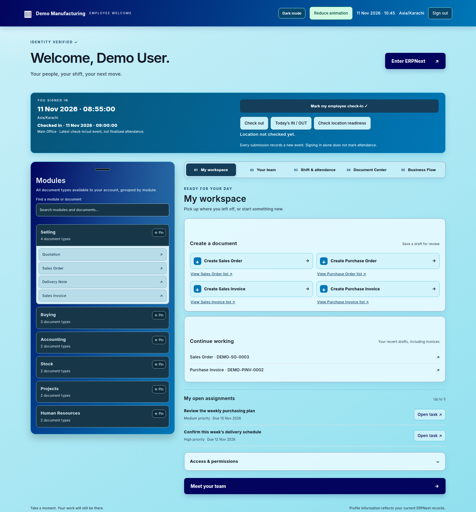
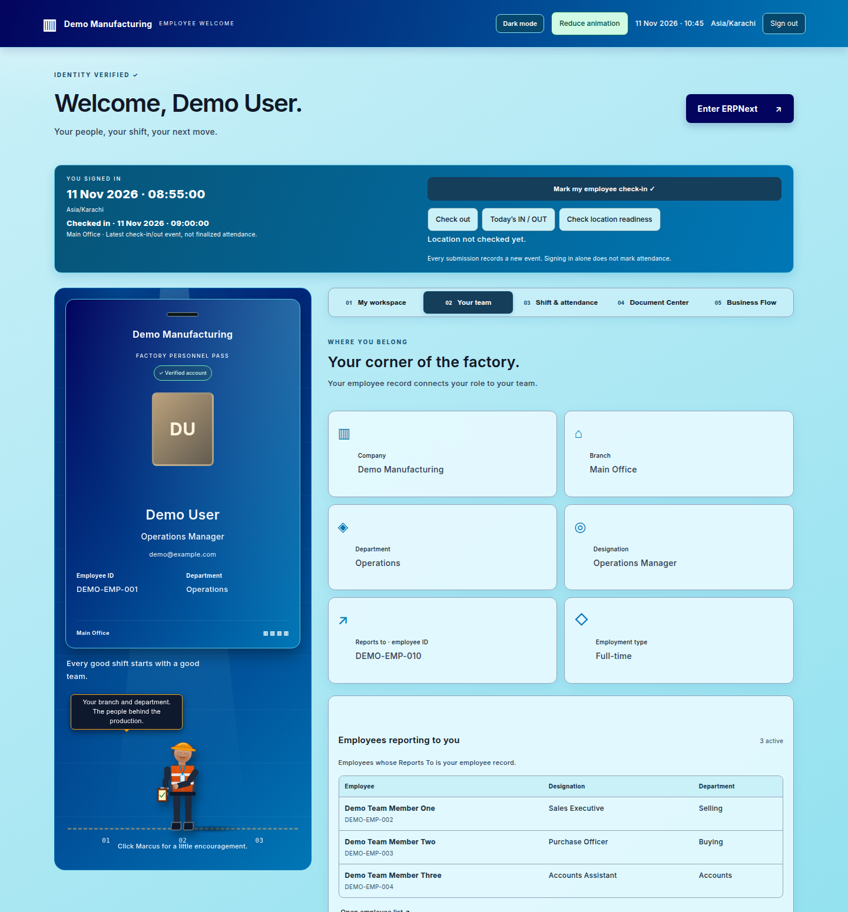
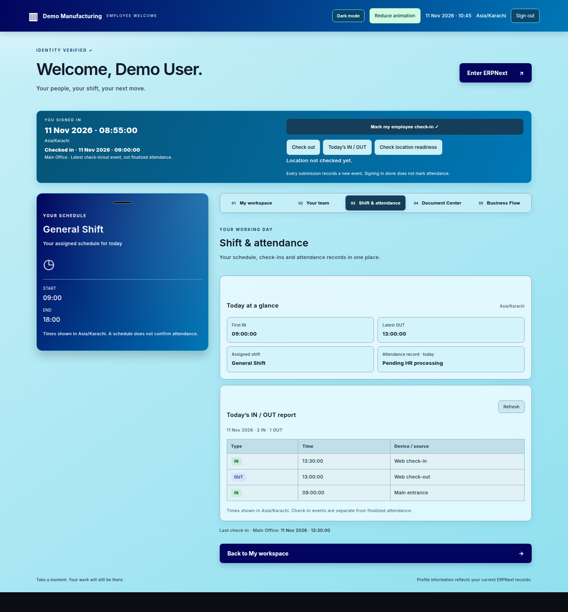
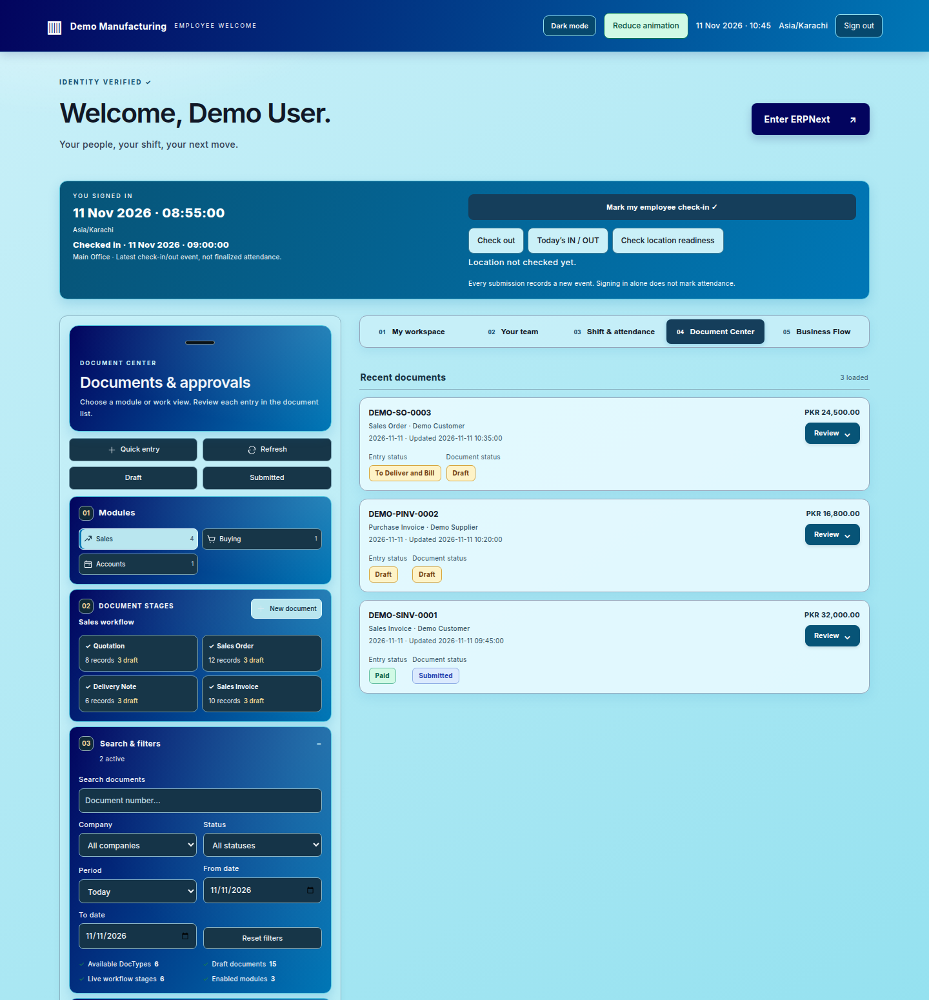
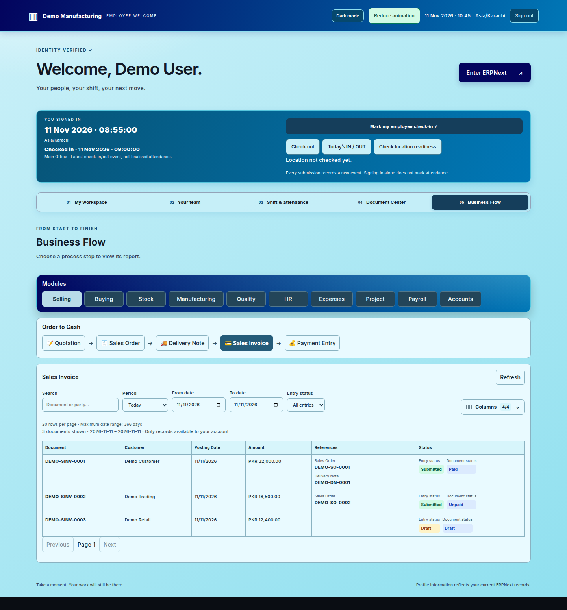
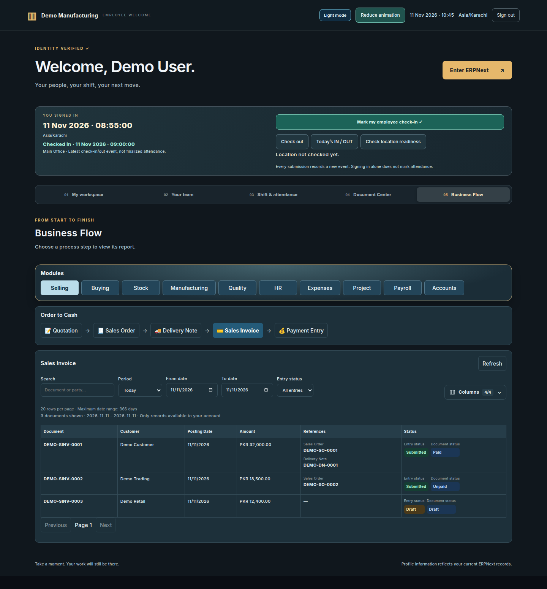

# My Space


A personal workspace for Frappe and ERPNext v16: document entry, approvals, business reporting, employee information, and attendance in one place.

**App package:** `my_space` · **Main route:** `/welcomes` · **License:** MIT

## Features

| Tab | What it provides |
| --- | --- |
| **My workspace** | Permission-aware module navigation, document creation, recent drafts, and open assignments. |
| **Your team** | Employee ID card, organizational details, and permitted direct reports. |
| **Shift & attendance** | Assigned shift, today at a glance, employee check-in/out, and a visible daily IN/OUT report. |
| **Document Center** | Document search, separate entry/document statuses, inline review, approval selection, and native document actions. |
| **Business Flow** | Reporting tables grouped by business process, linked document references, date filters, and selectable columns. |

- Light and dark themes with responsive layouts.
- Dedicated Sales Order, Purchase Order, Sales Invoice, and Purchase Invoice forms.
- Explicit Save, continued draft editing, same-page Submit, and read-only submitted documents.
- Item lookup, barcode entry, quantity controls, company-filtered tax templates, and invoice Update Stock.
- Native Frappe permissions and ERPNext validations, with stale-document protection on draft updates and submission.
- Reporting defaults to **Today**, with **This week**, **This month**, **This year**, and **Custom range** options. Lists use 20-row pages; custom date ranges are limited to 366 days on the server.
- Business Flow stays focused on reporting; entry and workflow actions remain in their dedicated interfaces.

## Screenshots

These pictures render the app's actual templates, styles, and UI rendering code with **synthetic demonstration data**. They are documentation previews, not captures of production employee or accounting records.

### My workspace



### Your team



### Shift & attendance



### Document Center



### Business Flow



### Dark theme



## Requirements

- A working Frappe / ERPNext v16 bench.
- The **`flow`** app installed on the target site. My Space currently reuses its factory login, shared visual assets, supervisor illustration, and personal check-in APIs; `required_apps` declares this dependency.
- **HRMS** for employee, shift, and attendance features.
- Appropriate Desk roles and document permissions. Available modules, records, and actions follow the signed-in user's access.

## Installation

Install ERPNext and the required `flow` app first, then run:

```bash
cd /path/to/frappe-bench
bench get-app --branch main https://github.com/ERPNEXT-PAKISTAN/My-Space.git
bench --site your-site.example install-app my_space
bench build --app my_space
bench --site your-site.example migrate
bench --site your-site.example clear-cache
bench restart
```

Open `/welcomes` on your site or select **My Space** on ERPNext Desktop.

For the employee views, link an active Employee to the user's account, configure its shift, and set **Reports To** on team members. Check-ins record events; finalized Attendance remains subject to HRMS processing and configuration.

## Routes

| Route | Purpose |
| --- | --- |
| `/welcomes` | Main My Space application |
| `/my-space-process` | Opens the Business Flow tab |
| `/my-space-sales-order` | Sales Order form |
| `/my-space-purchase-order` | Purchase Order form |
| `/my-space-sales-invoice` | Sales Invoice form |
| `/my-space-purchase-invoice` | Purchase Invoice form |

Use `?name=DOCUMENT-NUMBER` on an entry route to reopen an existing permitted document. Drafts remain editable when allowed; submitted and cancelled documents are read-only in these forms.

## Existing installations named `arabic`

The internal package is now **`my_space`** and the display name is **My Space**. A legacy installation requires a coordinated migration of its package, installed-app registry, module records, imports, and assets. Do not uninstall the old app as a rename procedure. Take a full site backup and preserve existing standard records during migration.

Legacy whitelisted API URLs are mapped to the new namespace in `my_space/compatibility.py` for clients opened before the rename. All current application code uses the `my_space` namespace.

## Development

The main website lives in `my_space/www/welcomes.*`. Shared entry forms use `my_space/entry.py` and `my_space/public/js/entry.js`; reporting uses `my_space/process.py`; document review is under `my_space/review/`.

After changes, rebuild bundled assets where needed, clear the site's cache, and restart web/workers after Python changes. Deployment checks should include intended-user permissions, draft save/update/submit behavior, report date limits, and light/dark/mobile views.

## License

[MIT](license.txt).
